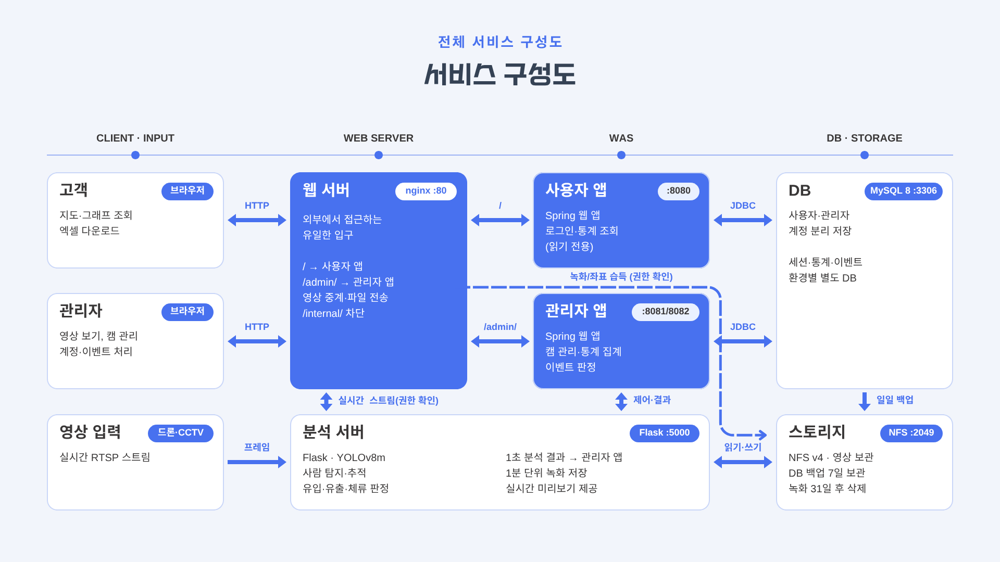
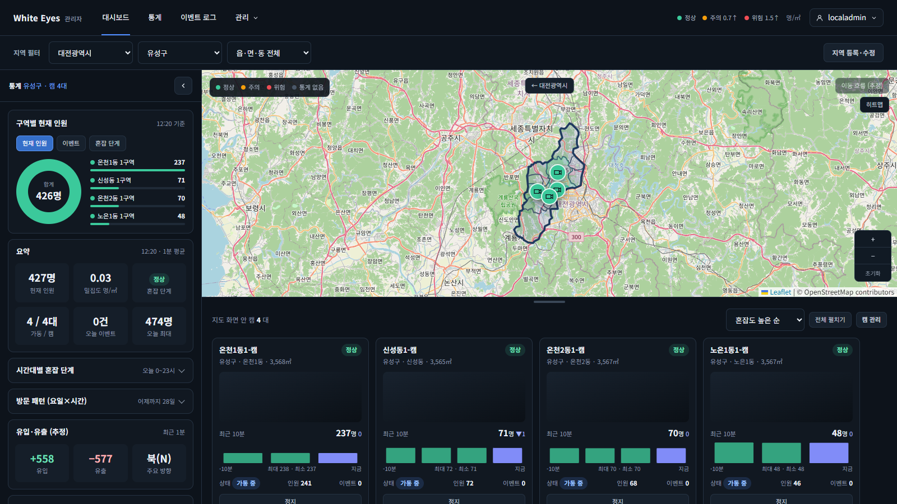
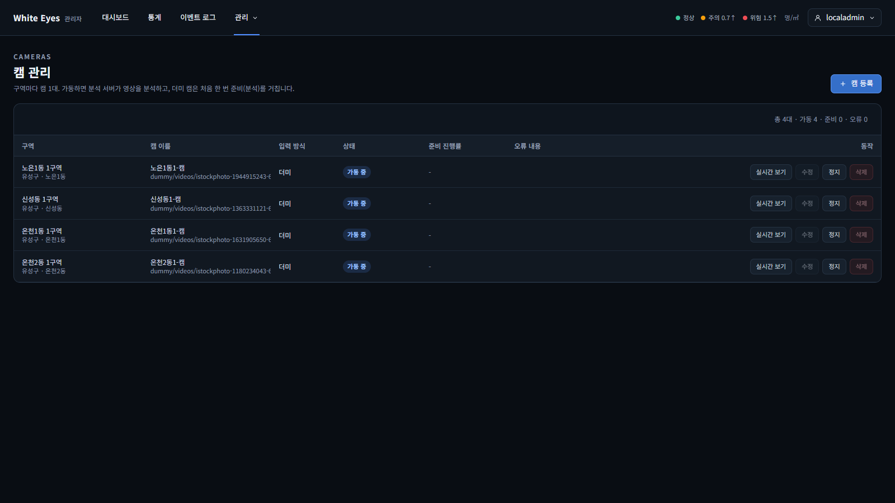

# white-eyes-flask

White Eyes의 **영상 분석 서버**(Flask). 드론·CCTV 영상에서 사람을 찾아 따라가며 인원, 방향별 유입/유출, 체류 시간을 계산해 관리자 앱에 보낸다. 분석하는 동안 영상을 녹화하고, 관리자 화면에 박스를 그린 실시간 화면을 내보낸다.

> 프로젝트 전체 소개: [white-eyes-introduce](https://github.com/white-eyes1/white-eyes-introduce) · 명세: [features/analyzer.md](https://github.com/white-eyes1/white-eyes-docs/blob/main/features/analyzer.md), [api/analyzer.md](https://github.com/white-eyes1/white-eyes-docs/blob/main/api/analyzer.md) · 앱: [white-eyes-spring](https://github.com/white-eyes1/white-eyes-spring) · 전체 실행: [white-eyes-deploy](https://github.com/white-eyes1/white-eyes-deploy)


## 목차
- [전체 구성에서의 위치](#전체-구성에서의-위치)
- [하는 일](#하는-일)
- [분석 결과가 화면에서 쓰이는 모습](#분석-결과가-화면에서-쓰이는-모습)
- [앱과 주고받는 API](#앱과-주고받는-api)
- [구조](#구조)
- [기술 스택](#기술-스택)
- [실행](#실행)
- [테스트](#테스트)
- [녹화 파일 정리](#녹화-파일-정리-fnc-s-014)
- [의존성](#의존성)
- [가중치](#가중치)
- [알려진 한계](#알려진-한계)
- [vendor/ 출처](#vendor-출처)

## 전체 구성에서의 위치



그림에서 아래쪽에 있는 '분석 서버'가 이 저장소다. 관리자 앱이 시키는 대로 영상을 분석하고, 그 결과를 다시 관리자 앱으로 돌려보낸다.

## 하는 일

| 기능 | 설명 | 명세 |
|---|---|---|
| 사람 탐지·추적 | VisDrone YOLOv8m으로 사람을 찾고, 박스가 아니라 **중심점 거리**로 같은 사람을 잇는 PointTracker로 추적한다 | FNC-S-003 |
| 유입/유출·체류 시간 | 화면 네 변 안쪽의 판정선을 넘은 사람을 방향별로 세고, 떠난 사람의 체류 시간을 계산한다 | FNC-S-004, 005 |
| 결과 전송 | 분석 결과를 1초마다 관리자 앱에 보낸다. 실패하면 최근 5분 치까지 보관했다가 다시 보낸다 | FNC-S-006 |
| 라이브 캠 | RTSP 스트림을 받아 분석하고, 원본 영상과 프레임별 박스 좌표를 1분 단위로 녹화한다. 끊기면 다시 연결한다 | FNC-S-007, 008 |
| 더미 캠 | 영상을 처음부터 끝까지 한 번 분석해 결과를 캐시로 저장하고, 이후에는 흐른 시간으로 캐시에서 꺼내 쓴다. 영상이 끝나면 처음으로 돌아간다 | FNC-S-009, 010 |
| 실시간 화면 | 박스를 그린 MJPEG 스트림과, 캠 카드용 JPEG 스냅샷을 내보낸다 | FNC-S-011 |
| 재시작 복구 | 다시 켜지면 관리자 앱에서 '가동 중인 캠' 목록을 받아 자동으로 다시 가동한다 | FNC-S-012 |
| 녹화 파일 정리 | 31일 지난 라이브 녹화를 지운다(cron 스크립트) | FNC-S-014 |

GPU 없이 CPU로 돌리다 보니 가벼운 모델과 낮은 분석 프레임 수(`ANALYZE_FPS`)를 쓴다. 그래서 실시간 분석은 라이브 캠 1대만 하고, 나머지는 더미 캠으로 등록해 둔다. 앱 입장에서는 둘 다 똑같은 형식의 결과가 오기 때문에 차이를 신경 쓸 필요가 없다.

## 분석 결과가 화면에서 쓰이는 모습

이 서버가 1초마다 보내는 결과를 관리자 앱이 모아서 대시보드와 캠 관리 화면에 보여 준다.

| 대시보드(캠 카드: 최근 10분 인원, 가동 상태) | 캠 관리(가동·정지 지시) |
|---|---|
|  |  |

> 캠 카드의 원본 영상 화면은 가려서 캡처했다. 실시간 화면은 [white-eyes-deploy](https://github.com/white-eyes1/white-eyes-deploy)로 직접 띄워 확인할 수 있다.

## 앱과 주고받는 API

외부에는 열어 두지 않았다. 관리자 앱(시작·정지 지시)과 웹 서버(실시간 화면)만 접근할 수 있다. 모든 요청은 `X-Internal-Token` 헤더의 내부 토큰으로 확인한다. 자세한 요청·응답은 [api/analyzer.md](https://github.com/white-eyes1/white-eyes-docs/blob/main/api/analyzer.md)에 있다.

**이 서버가 제공하는 API (`/analyzer/v1`)**

| 메서드·경로 | 설명 |
|---|---|
| `POST /cameras/{id}/start` | 캠 분석 시작 |
| `POST /cameras/{id}/stop` | 캠 분석 정지 |
| `GET /cameras/{id}/live` | 실시간 화면(MJPEG 스트림) |
| `GET /cameras/{id}/snapshot` | 카드 미리보기(JPEG 1장) |
| `GET /health` | 상태 확인 |

**이 서버가 관리자 앱에 호출하는 API (`/internal/v1`)**

| 메서드·경로 | 설명 |
|---|---|
| `POST /results` | 분석 결과 전송(1초마다) |
| `PATCH /cameras/{id}/status` | 캠 상태·준비 진행률 보고 |
| `POST /recordings` | 녹화 등록 |
| `GET /cameras/desired` | 가동 중인 캠 목록 조회(재시작 복구) |

## 구조

```
src/white_eyes_flask/
├─ analysis/    탐지(detector), 추적(point_tracker), 유입/유출(edge_counter), 더미 캐시
├─ camera/      캠 시작·정지, 더미 재생·준비, 결과 전송 큐, 상태·녹화 보고, 재시작 복구
├─ live/        라이브 스트림 입력과 분석
├─ recording/   1분 단위 녹화, 박스 좌표 파일, ffmpeg 인코딩
├─ stream/      실시간 화면(MJPEG)·스냅샷
└─ common/      공통 예외
tests/          pytest
ops/            녹화 파일 정리 cron 스크립트 (앱과 따로 실행)
vendor/         외부 코드(YOLO-CROWD), 수정하지 않음
```

패키지 배치와 계층 규칙은 [package-structure.md](https://github.com/white-eyes1/white-eyes-docs/blob/main/package-structure.md), 코드 컨벤션은 [code-conventions.md](https://github.com/white-eyes1/white-eyes-docs/blob/main/code-conventions.md)를 따른다.

## 기술 스택

| 영역 | 내용 |
|---|---|
| 언어·프레임워크 | Python 3.12, Flask |
| 탐지 | Ultralytics YOLOv8 + VisDrone 가중치(`DETECTOR=visdrone`) |
| 추론 | PyTorch(CPU 전용, 2.6.0 고정) |
| 영상 처리 | OpenCV(프레임 읽기·박스 그리기), ffmpeg(녹화 영상을 브라우저 재생 형식으로 인코딩) |
| 좌표 파일 | 프레임별 박스 좌표를 gzip 압축 JSON으로 저장(녹화 파일과 같은 이름) |
| 패키지 관리 | uv |
| 품질 | pytest, Black, isort, GitHub Actions |

모델을 고른 근거와 측정 결과는 [decisions/0015](https://github.com/white-eyes1/white-eyes-docs/tree/main/decisions)에 있다.

## 실행

```bash
uv sync
cp .env.example .env   # INTERNAL_API_TOKEN, YOLO_WEIGHTS 채우기
uv run white-eyes-flask
curl -H "X-Internal-Token: <토큰>" localhost:5000/analyzer/v1/health
```

전체 서비스와 함께 띄우려면 [white-eyes-deploy](https://github.com/white-eyes1/white-eyes-deploy)를 쓴다.

## 테스트

```bash
uv run pytest
uv run black . && uv run isort .   # 형식 정리 (CI는 --check로 확인, vendor/는 건너뜀)
```

## 녹화 파일 정리 (FNC-S-014)

스토리지 서버의 cron이 매일 04:00에 `ops/cleanup_recordings.sh`를 돌린다. `find`로 `recordings/live`의 31일 지난 `.mp4`·`.json.gz`를 지우고, 비게 된 날짜 폴더를 지운다. `MEDIA_ROOT`(기본 `/srv/media`)만 바꿀 수 있고, 경로를 `recordings/live`로 고정해 `dummy/`는 건드리지 않는다. 분석 서버 앱과는 따로 실행한다.
```
0 4 * * * MEDIA_ROOT=/srv/media /path/to/ops/cleanup_recordings.sh
```

## 의존성

`pyproject.toml`/`uv.lock`이 원본이고, `requirements.txt`(실행용)와 `requirements-dev.txt`(+pytest)는 버전까지 고정한 내보내기본이다. 의존성을 바꾼 뒤 다시 만든다.

```bash
uv export --no-dev --no-hashes --no-emit-project -o requirements.txt
uv export --no-hashes --no-emit-project -o requirements-dev.txt
```

Python 버전은 `.python-version`(3.12.15)에 고정.

`torch`는 CPU 전용으로 `2.6.0`에 고정했다(Windows 최신 torch 오류: `docs/troubleshooting/0002-torch-dll-init-windows.md`). Linux에서는 `uv`가 PyTorch CPU 저장소(`https://download.pytorch.org/whl/cpu`)에서 받는다. `requirements.txt`로 `pip`을 쓸 때는 같은 주소를 같이 준다.

```bash
pip install -r requirements.txt --extra-index-url https://download.pytorch.org/whl/cpu
```

## 가중치

모델 가중치(`*.pt`)는 저장소에 올리지 않는다(`weights/`는 `.gitignore`). `YOLO_WEIGHTS` 환경변수로 파일 경로를 알려 주면 된다.

### VisDrone YOLOv8m

드론처럼 위에서 내려다본 사람을 찾도록 학습된 모델이다. 출처는 https://huggingface.co/mshamrai/yolov8m-visdrone 의 `best.pt`이고, 시험에 쓴 파일은 아래 해시와 같다. 라이선스는 **PM이 정할 때까지 미확인**이다(Ultralytics AGPL-3.0, 학습 데이터 VisDrone은 연구 목적 공개). 그래서 이 저장소에는 올리지 않았다. 가중치 파일은 pickle 형식이므로 믿을 수 있는 곳에서 받은 파일만 쓴다.

```bash
curl -L -o weights/visdrone-yolov8m.pt https://huggingface.co/mshamrai/yolov8m-visdrone/resolve/main/best.pt
sha256sum weights/visdrone-yolov8m.pt   # Windows PowerShell: (Get-FileHash weights\visdrone-yolov8m.pt).Hash
# SHA-256: C1A19706FE83E8282795FB6C6CEC6A5E2A6E515C9B5FE4F558863D987EE24F8B (52,006,688바이트)
```

`.env`에는 `YOLO_WEIGHTS=./weights/visdrone-yolov8m.pt`처럼 적는다. 입력 크기는 `DETECT_IMGSZ`(기본 960), 같은 사람을 둘로 센 박스를 합치는 기준은 `DETECT_DEDUPE_OVERLAP`(기본 0=합치지 않음, 켜려면 0.25 정도)이다.

## 알려진 한계

- 센 인원은 실제보다 적게 나온다(사진 120장으로 재 보니 약 60~65%). 그래서 화면에서는 '추정 인원'과 상대적인 지표로만 쓴다.
- 탐지가 놓치면 추적이 끊겨 유입/유출·체류 시간이 틀어진다. 나가는 사람은 끝까지 따라가 유출로 세지만 들어오는 사람은 탐지가 늦어 유출이 유입보다 많이 나올 수 있다.
- 입력 960은 일반 PC에서 초당 5프레임을 못 맞춘다. 느리면 `ANALYZE_FPS`나 입력 크기를 낮춘다.
- 전체 목록은 [overview.md의 '알려진 한계'](https://github.com/white-eyes1/white-eyes-docs/blob/main/overview.md)에 있다.

## vendor/ 출처

`vendor/yolo_crowd/`는 YOLO-CROWD가 쓰는 YOLOv5 모델 코드(`models/`, `utils/`)를 그대로 복사한 것이다. 수정하지 않았다.

- 출처: https://github.com/zaki1003/YOLO-CROWD (커밋 `fbe4f633a40f250e1fafe7ac777f280623c1445a`, 2025-11-04)
- 라이선스: `vendor/yolo_crowd/LICENSE` (YOLO-CROWD, MIT)
- 이 코드는 Ultralytics YOLOv5(https://github.com/ultralytics/yolov5)에서 파생됐다. YOLOv5 v5.0의 라이선스(GPL-3.0)를 `vendor/yolo_crowd/LICENSE.yolov5`에 함께 둔다. 파생 코드의 실제 적용 라이선스는 배포 전에 확인이 필요하다.
- 코드가 `import models`, `from utils...`처럼 최상위 패키지로 서로를 가져오므로, 불러올 때 `vendor/yolo_crowd`를 `sys.path`에 넣어야 한다.
